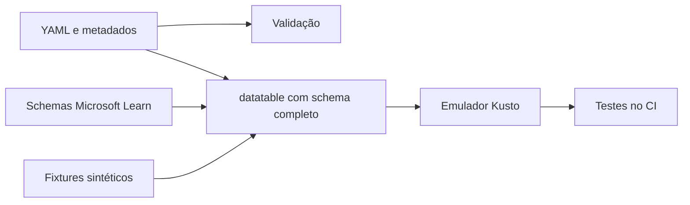

# kql-detection-as-code

[](https://github.com/ptkthg/kql-detection-as-code/actions/workflows/ci.yml)

Original KQL detections for Microsoft Defender XDR, versioned and tested as code.
Synthetic fixtures run against the official Kusto emulator with full documented table schemas.

**Aviso:** Detecções escritas do zero a partir de documentação pública (Microsoft Learn e MITRE ATT&CK).
Não contém conteúdo de empregadores atuais ou anteriores. Todos os dados de teste são sintéticos.

O projeto demonstra detecção como código: consultas revisáveis, metadados versionados e testes antes
da adoção em produção. Cada regra possui um positivo com ruído benigno e um negativo parecido benigno
para explicitar o raciocínio sobre falsos positivos. Nenhum comando dos fixtures é executado no host.

## Como funciona



O cliente usa `urllib`, sem SDK. Para cada cenário, declara a tabela com **todas** as colunas oficiais,
preenche os campos ausentes com o nulo do tipo (string vazia para `string`) e executa a query no motor.
Uma coluna inexistente na consulta produz erro de compilação, em vez de ser aceita por uma simulação.
O validador local confere metadados, fixtures e tipos; a compilação KQL acontece no emulador.

## Detecções

<!-- deteccoes:inicio -->

| ID | Título | Técnicas | Táticas | Severidade |
| --- | --- | --- | --- | --- |
| [KDAC-001](detections/KDAC-001-powershell-codificado.yaml) | PowerShell com comando codificado | [T1059.001](https://attack.mitre.org/techniques/T1059/001/) | execution | media |
| [KDAC-002](detections/KDAC-002-office-interpretador.yaml) | Office ou Outlook iniciando interpretador de script | [T1204.002](https://attack.mitre.org/techniques/T1204/002/), [T1566.001](https://attack.mitre.org/techniques/T1566/001/) | execution, initial-access | alta |
| [KDAC-003](detections/KDAC-003-certutil-download.yaml) | certutil baixando arquivo | [T1105](https://attack.mitre.org/techniques/T1105/) | command-and-control | media |
| [KDAC-004](detections/KDAC-004-mshta-rundll32-script.yaml) | mshta remoto ou execução de script por binário do sistema | [T1218.005](https://attack.mitre.org/techniques/T1218/005/), [T1218.011](https://attack.mitre.org/techniques/T1218/011/) | defense-evasion | alta |
| [KDAC-005](detections/KDAC-005-comsvcs-minidump.yaml) | Possível dump do LSASS via comsvcs MiniDump | [T1003.001](https://attack.mitre.org/techniques/T1003/001/) | credential-access | alta |
| [KDAC-006](detections/KDAC-006-schtasks-create.yaml) | Criação de tarefa agendada com schtasks | [T1053.005](https://attack.mitre.org/techniques/T1053/005/) | execution, persistence | media |
| [KDAC-007](detections/KDAC-007-net-conta-local.yaml) | Criação de conta local ou inclusão em administradores | [T1098](https://attack.mitre.org/techniques/T1098/), [T1136.001](https://attack.mitre.org/techniques/T1136/001/) | persistence | alta |
| [KDAC-008](detections/KDAC-008-password-spray.yaml) | Possível password spray por IP | [T1110.003](https://attack.mitre.org/techniques/T1110/003/) | credential-access | alta |

<!-- deteccoes:fim -->

Para visualizar a cobertura, baixe [navigator/layer.json](navigator/layer.json), abra o
[ATT&CK Navigator](https://mitre-attack.github.io/attack-navigator/) e use **Open Existing Layer → Upload from local**.
O comentário de cada técnica relaciona os IDs KDAC. O mapeamento indica hipótese de cobertura, não confirmação de ataque.

## Executar localmente

Instale [uv](https://docs.astral.sh/uv/) e Docker com suporte a contêineres Linux. Em um terminal:

```sh
docker run --rm --name kdac-kusto -e ACCEPT_EULA=Y -p 8080:8080 mcr.microsoft.com/azuredataexplorer/kustainer-linux@sha256:81bb7fc1cdda3ee96f725221bbf37b525eca32718d2c2c6a4a6522f84ec97458
```

Em outro terminal, aguarde o emulador responder e execute:

```sh
uv sync --locked
uv run python -m kdac.validar
uv run python -m kdac.documentar --check
uv run pytest
```

O padrão é `http://localhost:8080`, banco `NetDefaultDB`; configure `KDAC_KUSTO_URL` para outro endereço.
O timeout por consulta é 30 segundos. Sem o emulador, os testes de detecção são pulados com uma mensagem
explícita; o CI espera a saúde e falha se o serviço não iniciar. Os testes unitários independem do serviço:

```sh
uv run pytest tests/test_validar.py tests/test_documentar.py
```

## Adicionar uma detecção

1. Confira o schema completo na página oficial da tabela e registre fonte e data em `schemas/defender/`.
2. Crie `detections/KDAC-NNN-slug.yaml` com descrição, ATT&CK, falsos positivos, referências e query comentada.
3. Adicione fixtures em `tests/fixtures/KDAC-NNN/`: positivo com evento suspeito e ruído benigno; negativo só com parecidos benignos. Na v1, cada detecção usa uma tabela.
4. Execute `uv run python -m kdac.validar` e `uv run pytest` com o emulador ativo.
5. Gere o catálogo com `uv run python -m kdac.documentar` e confira com `--check`.

## Fontes e limitações

- [DeviceProcessEvents](https://learn.microsoft.com/en-us/defender-xdr/advanced-hunting-deviceprocessevents-table): 69 colunas conferidas em 24/11/2026, incluindo `LogonId` **e** `LogonID`, conforme a página.
- [EntraIdSignInEvents](https://learn.microsoft.com/en-us/defender-xdr/advanced-hunting-entraidsigninevents-table): 52 colunas conferidas na mesma data. Sucede `AADSignInEventsBeta` e exige Entra ID P2. O título público ainda inclui “preview”, mas o corpo informa que a substituição em 19/10/2026 remove esse status; confirme a disponibilidade no seu tenant.
- O emulador não é o Defender: não há dados reais, cadência de ingestão nem validação de licenças ou permissões.
- Dados sintéticos não reproduzem volume de produção. O projeto não mede desempenho em escala nem eficácia operacional.
- A KDAC-008 usa janelas **fixas** de 30 minutos e até três falhas por conta; seus limiares exigem ajuste por ambiente. Atividade que atravessa a borda da janela, pulverizada em vários IPs ou muito lenta pode não aparecer. Erros de autenticação não provam tentativa de senha; NAT e proxies podem gerar falsos positivos.
- A KDAC-005 não resolve o PID alvo: detecta a invocação de MiniDump, sem provar acesso ao LSASS. A KDAC-002 não comprova phishing. A KDAC-007 cobre o nome inglês `administrators`; nomes localizados de grupo exigem ajuste.
- As regras de linha de comando são heurísticas: variações de escape, ofuscação e binários renomeados exigem outras análises. Não são regras prontas de custom detection: o agendamento e os campos exigidos no Defender precisam ser revisados para implantação.

Licença [MIT](LICENSE).
